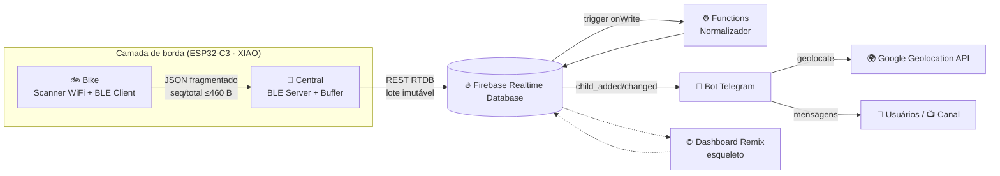
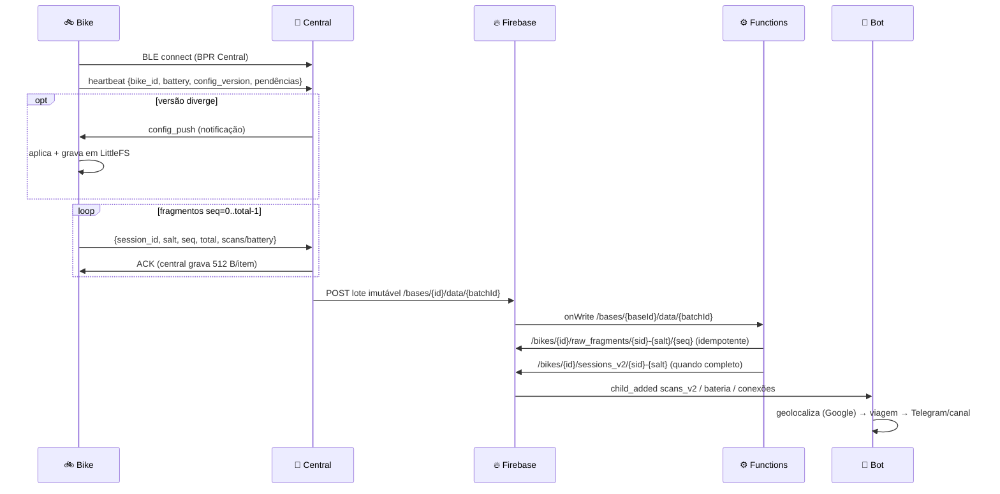
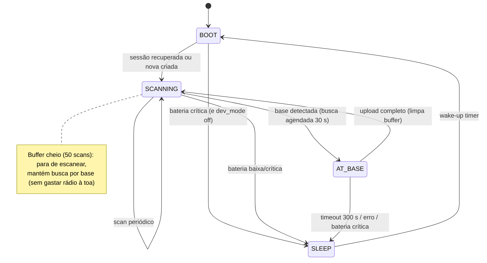
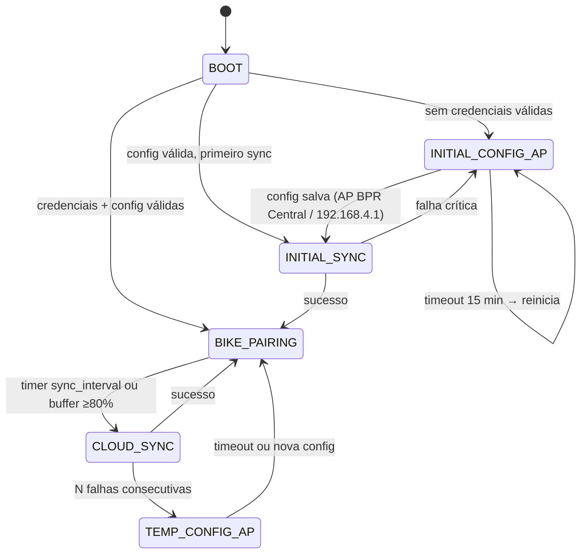
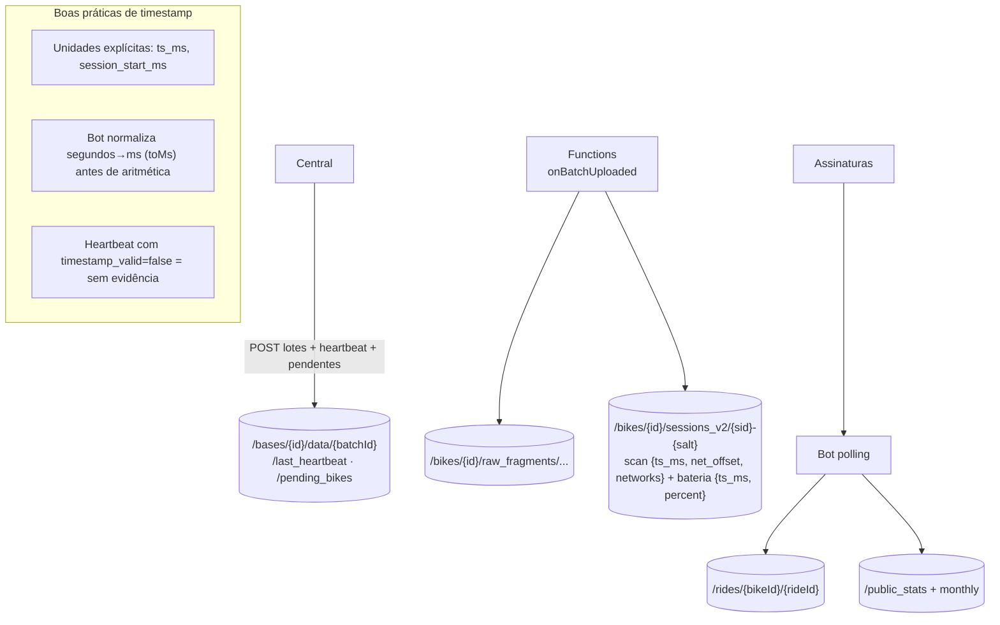

# BPR Sistema — Monorepo

Sistema de **monitoramento de bicicletas compartilhadas** que coleta amostras Wi-Fi
no próprio veículo, transporta os dados por BLE até uma central de base, sincroniza
com o Firebase Realtime Database e executa geolocalização/estatísticas em um bot
Telegram. Inclui um dashboard web (esqueleto Remix) e um normalizador serverless
(Firebase Functions) que remonta sessões fragmentadas.

> **Levantamento rápido:** [Arquitetura](docs/ARCHITECTURE.md) ·
> [Modelo de dados](docs/DATA_MODEL.md) · [Protocolo BLE](docs/PROTOCOL_BLE.md) ·
> [Operação](docs/OPERATIONS.md)

## Visão geral



## Estrutura do repositório

```
bpr-sistema/
├── firmware/
│   ├── bici/            # Bike: ESP32-C3 (Seeed XIAO), WiFi scanner + BLE client
│   ├── central/         # Central: ESP32-C3 (Seeed XIAO), BLE server + sync Firebase
│   └── common/          # Cabeçalhos compartilhados (UUIDs BLE, tipos, IDs)
├── bot/
│   ├── src/             # Runtime long-polling (Telegraf): index.js, config/, services/, utils/
│   ├── functions/       # Firebase Functions (TypeScript): triggers + webhook
│   ├── scripts/         # test/, webhook/, setup/, data/
│   ├── docs/            # Guias de deploy/fluxo do bot
│   └── tools/           # route-viewer.html, run.sh, fix-permissions.sh
├── web/                 # Dashboard Remix + Vite (só root.jsx — interface futura)
├── docs/                # Documentação canônica deste repositório
├── BIKE_CENTRAL_PROTOCOL.md, BIKE_PAIRING_DIAGRAM.md, INTERACAO_BIKE_CENTRAL.md, ... # legado
├── config.example.json         # Contrato de configuração Firebase (bases/bikes)
├── decode_hub_data.js, diagnose.sh
└── melhorias/           # Análises e artefatos de correção (histórico)
```

### Hardware e build (valores do código)

| Componente | Placa alvo | Framework | Partição | MTU BLE | Notas |
|---|---|---|---|---|---|
| `firmware/bici` | `seeed_xiao_esp32c3` | Arduino + PlatformIO 8.0 | app 3 MiB / LittleFS 960 KiB | 512 (payload ≤460 B) | NimBLE 1.4.3, ArduinoJson 6.21.6 |
| `firmware/central` | `seeed_xiao_esp32c3` | Arduino + PlatformIO 8.0 | app 3 MiB / LittleFS 960 KiB | 512 | NimBLE 1.4.3, ArduinoJson, NTPClient, CRC32 |

Pinos: LED `8`, botão config `9` (bike), bateria `A0` (bike). Serial `115200`.

## Como funciona (ciclo ponta a ponta)

1. **Coleta na bike.** `ScanningState` faz scan Wi-Fi assíncrono a cada
   `wifi.scan_interval_sec`; guarda até 50 scans/sessão (até 20 redes/scan, filtro RSSI)
   e 10 leituras de bateria em estruturas binárias no LittleFS.
2. **Entrega por BLE.** Ao detectar a central `BPR Central`, a bike conecta, envia
   heartbeat (bateria %, heap, `config_version`, pendências) e transfere a sessão em
   **fragmentos `seq/total`** com ACK por fragmento. Fragmentos >460 B não existem:
   uma chunk = subconjunto de redes de um scan que cabe no pacote.
3. **Recepção na central.** A central valida `bike_id` (`bpr-XXXXXX`), aplica o
   registro `allowed` / `pending` / `blocked`, grava cada fragmento
   (item binário de 512 B + `session_id/salt/seq`, CRC32) e responde ACK/idle.
   Push de configuração ocorre automaticamente quando a versão diverge.
4. **Sincronização.** Em `CLOUD_SYNC`, a central baixa configs do Firebase, envia
   lotes imutáveis para `/bases/{base_id}/data/{batchId}`, publica heartbeat e
   bikes pendentes, depois retorna para `BIKE_PAIRING`.
5. **Normalização (Functions).** `onBatchUploaded` grava fragmentos brutos por
   `seq` e publica a projeção `sessions_v2/{sid}-{salt}` só quando todos os
   `0..total-1` existem — idempotente por identidade, sem duplicação em retry.
6. **Processamento (Bot).** O bot (polling) ou as Functions (webhook) escuta
   `sessions_v2`, geolocaliza cada scan no Google Geolocation, acumula viagens
   (`RideCalculator`), publica no canal público e notifica assinantes.



## Máquinas de estado (código real)

### Bike — 4 estados



Estados extintos no README antigo (`CONFIG_REQUEST`, `LOST`) **não existem mais**:
`STATE_LOST` era inalcançável e foi removido; busca por base é agendada (`BASE_SEARCH_INTERVAL_MS`).

### Central — 6 estados



## Contrato BLE

| Elemento | Valor (código atual) |
|---|---|
| Service | `12345678-1234-1234-1234-123456789abc` |
| Data characteristic | `87654321-4321-4321-4321-cba987654321` |
| Config characteristic | `11111111-2222-3333-4444-555555555555` |
| Nome anunciado | `BPR Central` |
| Formato bike_id | `bpr-` + 6 hex (`generateBikeId()` = eFuse MAC) |
| Mensagem payload | ≤460 B (MTU 512) com `seq/total/is_final` |
| Tipos | `status`, `wifi_data`, `config_request`, `config_push`, `config_received` (+ `upload_confirmed`, `busy` no protocolo histórico) |

> ⚠️ Documentações antigas exibem Data `...absd` / Config `...abse` (ex-`common/README.md`).
> O código atual usa `8765...` / `1111...`. **Bike e central devem ser reflashadas juntas.**
> Ver [docs/PROTOCOL_BLE.md](docs/PROTOCOL_BLE.md).

## Firebase — onde cada componente escreve



Visão resumida (detalhes em [docs/DATA_MODEL.md](docs/DATA_MODEL.md)):

- **Firebase RTDB** é a única fonte de verdade. Central escreve apenas **lotes
  imutáveis** + heartbeat; nunca reescreve histórico moderno nem cria `sessions`
  legadas.
- `sessions_v2/{sid}-{salt}` é a **projeção canônica** consumida pelo bot.
  Legados `sessions/{id}` (array `[ts, [...]]`) são normalizados (`normalizeScan`).
- Unidades de tempo são **normalizadas no consumidor** (segundos legados vs millis v2) —
  ver `rideCalculator.toMs()` e `normalizeScan/normalizeNetwork` em `geolocation.js`.

## Execução

```bash
# Firmware
cd firmware/bici    && pio run --target upload && pio device monitor
cd firmware/central && pio run --target upload && pio device monitor

# Bot (polling, desenvolvimento)
cd bot && cp .env.example .env && npm install && npm run dev

# Functions (webhook + normalizador)
cd bot && npm install && cd functions && npm run build && firebase deploy --only functions

# Web (esqueleto)
cd web && npm install && npm run dev   # http://localhost:5173
```

Variáveis obrigatórias (bot): `TELEGRAM_BOT_TOKEN`, `ADMIN_CHAT_ID`,
`FIREBASE_PROJECT_ID/DATABASE_URL/PRIVATE_KEY/CLIENT_EMAIL`,
`GOOGLE_GEOLOCATION_API_KEY`. Opcionais: `PUBLIC_CHANNEL_ID`,
`HEARTBEAT_CHECK_INTERVAL`, `RIDE_TIMEOUT`.

Detalhes de deploy, configuração da central (AP `BPR Central`, senha `botaprarodar`,
IP `192.168.4.1`), troubleshooting e runbook: [docs/OPERATIONS.md](docs/OPERATIONS.md).

## Componentes

### Firmware Bike
Inclui `ConfigManager` (config binária 96 B), `BufferManager` (sessão binária com
header magic/versão/CRC + gravação atômica), `PowerManager` (deep sleep, bateria)
e `AtBaseState` (BLE client com fila de notificações e retry de config).
Estruturas: `SessionData` até 50 scans × 20 redes + 10 baterias.

### Firmware Central
Inclui `BPRBLEServer` (NimBLE server, busy status, fila de pushes),
`BikePairing` (máquina de pareamento/filas), `BikeManager` (registro permitido/bloqueado),
`CloudSync` (HTTP REST ao RTDB), `BufferManager` (até 800 itens binários),
`ConfigAP` (portal de configuração), `LEDController` (Pin 8), `SelfCheck` e `TimeSync` (NTP).
Heartbeat do firmware é publicado em segundos Unix; o bot converte.

### Bot (duas implementações)
| | `bot/src` (polling) | `bot/functions` (serverless) |
|---|---|---|
| Entrada | Loop Telegraf | Webhook HTTPS `/telegramBot` |
| Listeners | polling `child_added` em `sessions_v2/scans` | triggers RTDB + webhook |
| Comandos | `/status /rota /bikes /estacao /seguir /parar /minhas /ping` | `/status /rota /bikes /converter` |
| Serviços | BikeMonitor, Geolocation, RideCalculator, StationMonitor, SubscriptionManager, ChannelPublisher | normalização + geolocalização sob demanda (`/converter` com cooldown 60 s) |

Ambas consumem a mesma projeção `sessions_v2`; **rodar as duas simultaneamente
duplica notificações**.

### Web
`web/app/root.jsx` é apenas o shell Remix/Vite. Não há integração Firebase ativa,
não há rotas de dashboard, mapas ou relatórios. Status: **esqueleto inicial**.

## Extras na raiz

- `config.example.json` — contratos Firebase para `bases/{}/configs` e `bike_configs/{}`.
- `BIKE_CENTRAL_PROTOCOL.md`, `BIKE_PAIRING_DIAGRAM.md`, `INTERACAO_BIKE_CENTRAL.md`,
  `FUNCTION_CALL_DIAGRAM.md`, `FUNCTION_CALL_MAP.md` — documentos de protocolo/fluxo
  (histórico, ainda úteis como referência).
- `decode_hub_data.js` — decodificador hex de amostras legadas.
- `diagnose.sh` — verificações rápidas (PlatformIO, USB, portas seriais).
- `melhorias/` — auditorias/análises de revisão do firmware.

Contribuição, licença (AGPL-3.0) e suporte detalhados: [docs/OPERATIONS.md](docs/OPERATIONS.md#10-contribuição).

