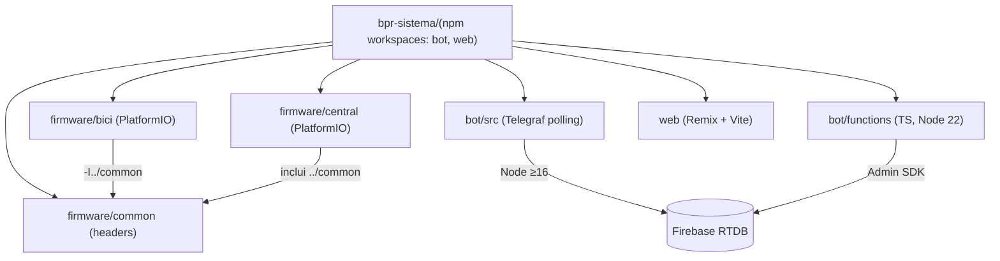
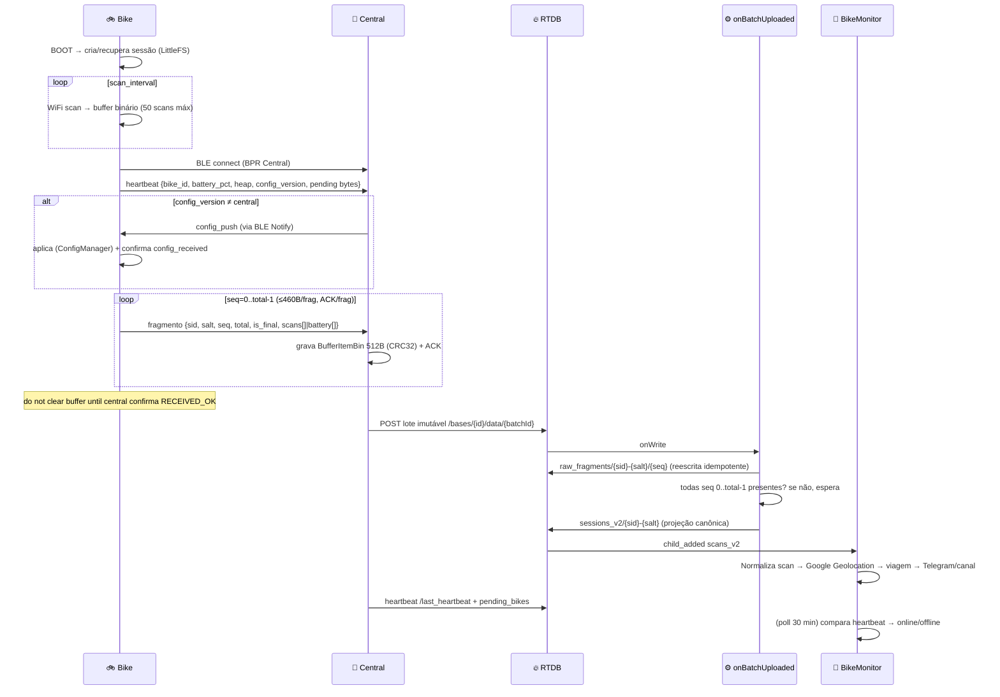
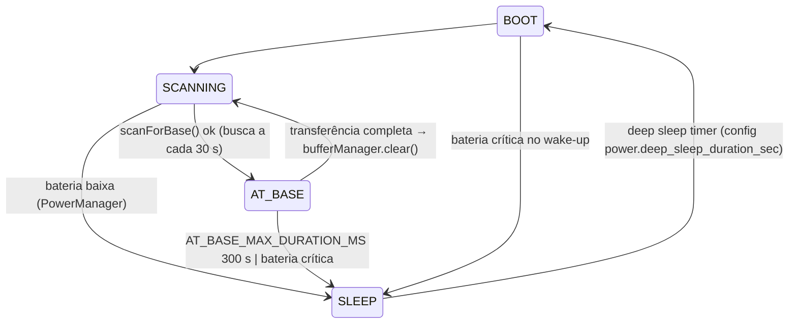
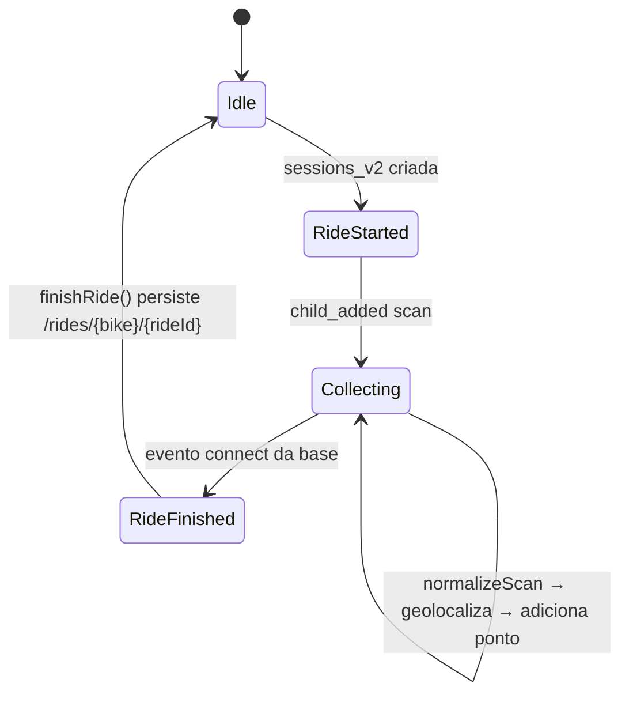
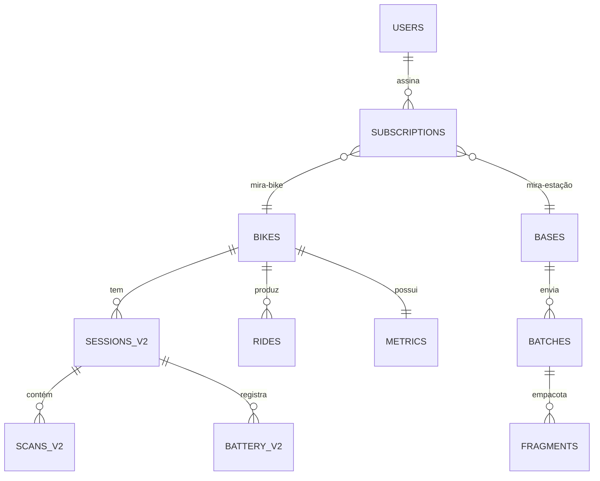

# Arquitetura — BPR Sistema

Documento canônico da arquitetura. Referência de código: `firmware/*/platformio.ini`,
`firmware/bici/src/main.cpp`, `firmware/central/src/main.cpp`,
`firmware/common/bpr_protocol.h`, `bot/src/`, `bot/functions/src/index.ts`.

## 1. Contexto e limites

```
┌─────────────────────────────── Sistema BPR ───────────────────────────────┐
│                                                                             │
│  Campo (bikes)                 Base (central)         Nuvem/navegador       │
│  ┌───────────┐   BLE 512B   ┌────────────┐   HTTPS   ┌──────────────┐       │
│  │ ESP32-C3  │ ───────────▶ │ ESP32-C3   │ ─────────▶ │ Firebase RTDB│       │
│  │ WiFi scan │  fragmentado │ NimBLE srv │   REST    │  + Functions │       │
│  └───────────┘              └────────────┘           └──────────────┘       │
│                                                                  │            │
│                                                                  ▼            │
│                                                        bot polling / webhook  │
│                                                                  │            │
│                                                                  ▼            │
│                                                    Telegram + Google APIs     │
│                                                                             │
│  Fora do núcleo: web/ (esqueleto Remix — sem integração ativa)              │
└─────────────────────────────────────────────────────────────────────────────┘
```

### 1.1 Módulos

| # | Módulo | Diretório | Responsabilidade |
|---|---|---|---|
| 1 | Bike | `firmware/bici/` | Escanear Wi-Fi, persistir sessão, entregar por BLE |
| 2 | Central | `firmware/central/` | Receber/validar BLE, buffer, sync Firebase, AP de config |
| 3 | Comum | `firmware/common/` | Confirmar UUIDs BLE e tipos compartilhados |
| 4 | Bot polling | `bot/src/` | Long-polling: comandos, assinaturas, monitoramento, canal |
| 5 | Functions | `bot/functions/` | Trigger normalizador `onBatchUploaded`, trigger `onSessionAssembled`, webhook `/telegramBot` |
| 6 | Web | `web/` | Esqueleto Remix — `app/root.jsx` apenas |

### 1.2 Monorepo



> A raiz `package.json` define workspaces `bot` e `web` com scripts
> (`dev:bot`, `dev:web`, `build:firmware:bici/central`). Não há `npm test` real de firmware;
> testes citados nos READMEs antigos não são executáveis no CI.

## 2. Ciclo de vida de uma sessão (ponta a ponta)



### 2.1 Decisões arquiteturais

| Decisão | Problema | Alternativas avaliadas | Motivo |
|---|---|---|---|
| Fragmentação `seq/total` | Sessão densa não cabe num MTU 512 | Compressão gzip / binário puro BLE | JSON fragmentado é legível, idempotente por `seq`, compatível com lotes Firebase |
| Lote imutável `data/{batchId}` | Retry não deve duplicar histórico | Sobreescrever `/data` | Reprocessamento gera o mesmo estado; replay não duplica |
| Projeção `sessions_v2` | Fragmentos brutos ≠ formato consultável | Bot processa fragmentos direto | Consumidores leem um único esquema com `ts_ms`, `networks[]`, `battery{ts_ms,percent}` |
| Buffer binário na bike | JSON em RAM estoura no ESP32-C3 | Buffer JSON na RAM |Estruturas packed reduzem heap ~3–5x |
| Relógio normalizado | Segundos (central) vs millis (bike) | Fixar um padrão no firmware | Normalização no consumidor (`toMs`) acomoda legado + v2 |

### 2.2 Disponibilidade e capacidade

- Sem central de backup: bikes coletam em buffer até 50 scans; com buffer cheio,
  param escaneamento e buscam base (política de saturação documentada, sem perda
  silenciosa). A central aceita até 10 bikes cadastradas, 800 itens binários
  (~429 KB payload) no LittleFS de 960 KiB.
- Bot polling mantém cache em memória (`activeRides`, `stationStatus`, assinaturas);
  reinício perde viagens ativas não persistidas (aceito: podróży completas estão no Firebase).
- Functions é stateless; Assemble espera até que todos os fragmentos cheguem
  (execuções repetidas recompõem sem gerar duplicatas).

## 3. Máquinas de estado internas

### 3.1 Bike — `firmware/bici/src/main.cpp`



`loop()` troca estado em um único ponto; `PowerManager.checkBatteryState()` pode
forçar `SLEEP` exceto durante transferência (`isTransferring()`).

### 3.2 Central — `firmware/central/src/main.cpp`

```mermaid
stateDiagram-v2
    BOOT --> INITIAL_CONFIG_AP: !credsLoaded || !isCredentialsValid
    BOOT --> INITIAL_SYNC: config válida mas isFirstSync
    BOOT --> BIKE_PAIRING
    INITIAL_CONFIG_AP --> INITIAL_SYNC: config salva → reinicia
    INITIAL_SYNC --> BIKE_PAIRING: SyncResult::SUCCESS
    INITIAL_SYNC --> INITIAL_CONFIG_AP: primeira sync falhou
    BIKE_PAIRING --> CLOUD_SYNC: elapsed ≥ sync_interval_ms() OU buffer 80%
    CLOUD_SYNC --> BIKE_PAIRING: SUCCESS
    CLOUD_SYNC --> TEMP_CONFIG_AP: SyncMonitor.shouldFallback (≥5 falhas)
    CLOUD_SYNC --> CLOUD_SYNC: FAILURE → retry backoff 30 s
    TEMP_CONFIG_AP --> BIKE_PAIRING: timeout config_ap_timeout_sec (300 s)
```

`BIKE_PAIRING` inicializa `BufferManager` lazy (heap-aware), registra callback LED;
`CLOUD_SYNC` faz (1) upload buffer, (2) heartbeat, (3) `uploadPendingBikes()`
(públicas descoberta), (4) downloads (`downloadCentralConfig`,
`downloadBikeRegistryData`, `downloadBikeConfigs`).

### 3.3 Bot polling — `bot/src/services/bikeMonitor.js`



`RideCalculator` descarta viagens <80 m. `toMs()` normaliza seg→ms. `scan` antigo
>10 min vira `isHistorical` (não anunciado como tempo real).

## 4. Comunicação

### 4.1 BLE: contrato em `docs/PROTOCOL_BLE.md`

- UUIDs e tipos em `firmware/common/bpr_protocol.h`; estruturas em `bpr_types.h`.
- Bike envia mensagens ≤460 B; central confirma por seq/total.
- Config push é **automático por versão** (não requer `config_request` manual).

### 4.2 Firebase REST (central → RTDB)

Construído por `Endpoints::buildUrl()` = `{DATABASE_URL}{path}?auth={API_KEY}`:

| Método | caminho | conteúdo |
|---|---|---|
| GET | `/bases/{id}/configs/last_update.json` | versão da config central |
| GET | `/bases/{id}/config.json`, `/configs/wifi.json` | config da central |
| GET | `/bases/{id}/bike_registry.json`, `/bikes/configs.csv` | cadastro + configs por bike (CSV) |
| POST/PUT | `/bases/{id}/data/{batchKey}.json` | lote de fragmentos (`data[]` com `seq`, `crc32`, `data_decoded`) |
| PUT | `/bases/{id}/last_heartbeat.json` | `{timestamp, bikes_connected, heap, uptime, timestamp_valid}` |
| PUT | `/bases/{id}/pending_bikes.json` | descobertas ainda não aprovadas |

O modelo completo de dados e responsabilidades de cada nó está em `docs/DATA_MODEL.md`.

## 5. Esquemas lógicos (ER de alto nível)



Ver `docs/DATA_MODEL.md` para chaves, exemplos JSON e regras de escrita.
