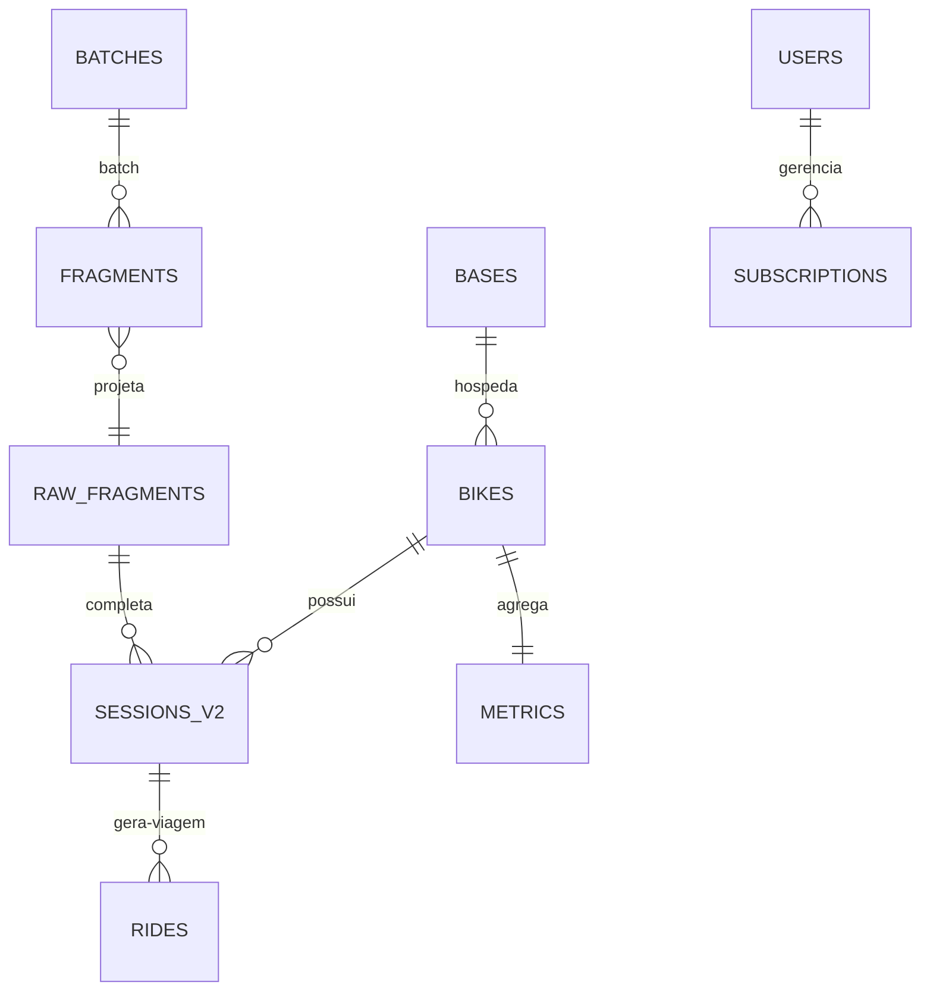

# Modelo de Dados — Firebase Realtime Database

Este documento define os contratos JSON. A **projeção canônica** é `sessions_v2`;
itens legados (`sessions/{id}`) existem por compatibilidade de leitura/escrita antiga
e devem ser normalizados pelos consumidores (`normalizeScan`, `normalizeNetwork`,
`normalizeNetworks` em `bot/src/services/geolocation.js`).

## 1. Visão da árvore

```
/
├── bases/{base_id}/
│   ├── config              # Configuração da central (REST: /config.json)
│   ├── configs/            # Metadata (last_update, wifi, buffer, led, limits, fallback...)
│   ├── bike_registry       # Cadastro (allowed/pending/blocked) — via CSV no sync
│   ├── bikes/              # Bikes conhecidas (visit_count, status)
│   ├── data/{batchId}      # Lotes imutáveis enviados pela central
│   ├── last_heartbeat      # Heartbeat da central (segundos Unix)
│   └── pending_bikes       # Descobertas locais aguardando aprovação
├── bike_configs/{bike_id}  # Parâmetros por bike (wifi/ble/power/battery/states)
├── bikes/{bike_id}/
│   ├── raw_fragments/{sid}-{salt}/{seq}   # Fragmentos brutos (Functions)
│   ├── batches/{sid}-{salt}/             # PRD lotes (BTP1): parts/{i} + meta
│   ├── batch_confirmations/{sid}-{salt}  # Conclusão canônica por origem
│   ├── sessions_v2/{sid}-{salt}            # Projeção canônica (Functions)
│   ├── sessions/{sessionId}                # (legado, leitura histórica)
│   └── metrics             # Agregados (km_total, rides_total, last_ride)
├── rides/{bike_id}/{rideId}
├── public_stats            # Agregados públicos + monthly/{YYYY-MM}
└── subscriptions/{userId}  # {bikes[], stations[], system}
```

## 2. Lote da central

Caminho: `/bases/{base_id}/data/{batchId}` (objeto com array `data`).
`batchId` é estável (`batchKey`); retries **não duplicam** — ver `Endpoints::getBufferDataBatch` e `CloudSync::uploadBufferData` (lote imutável).

```json
{
  "data": [
    {
      "bike_id": "bpr-000123",
      "ts": 1733459800,
      "size": 412,
      "crc32": "a1b2c3d4",
      "session_id": 45000,
      "session_salt": 2,
      "seq": 0,
      "data_decoded": {
        "session_id": 45000,
        "session_salt": 2,
        "seq": 0,
        "total": 3,
        "is_final": false,
        "boot_id": 7,
        "session_start_millis": 45000,
        "scans": [
          { "ts": 47000, "net_offset": 0, "nets": [["NET_5G", "AA:BB:CC:11:22:33", -70, 6]] }
        ],
        "battery": []
      },
      "data": "{...}"  // string JSON alternativa (mesma carga)
    }
  ]
}
```

> `data_decoded` ou `data` (string) devem estar presentes. `total ≤ 512`
> e `seq ∈ [0, total-1]`. Fragmentos inválidos são descartados sem falhar o lote
> (`onBatchUploaded` em `bot/functions/src/index.ts`).

## 3. Projeção v2 — sessão

Caminho: `/bikes/{bike_id}/sessions_v2/{session_id}-{salt}`

```json
{
  "schema_version": 2,
  "bike_id": "bpr-000123",
  "session_id": 45000,
  "session_salt": 2,
  "boot_id": 7,
  "resumed": false,
  "session_start_ms": 45000,
  "scan_count": 12,
  "scans": [
    {
      "scan_key": "i3",
      "idx": 3,
      "ts_ms": 47000,
      "net_offset": 0,
      "content_hash": "1a2b3c4d",
      "networks": [
        { "ssid": "NET_5G", "bssid": "AA:BB:CC:11:22:33", "rssi": -70, "channel": 6 },
        { "ssid": "NET_2G", "bssid": "AA:BB:CC:11:22:99", "rssi": -74, "channel": 11 }
      ]
    }
  ],
  "geo": {
    "i3": {
      "lat": -8.064,
      "lng": -34.882,
      "accuracy": 50,
      "base_hash": "1a2b3c4d",
      "source": "google_geolocation_v1",
      "computed_at": 1733460800000
    }
  },
  "battery": [ { "ts_ms": 47000, "percent": 85 } ],
  "complete": true,
  "ingest_ts": 1733459800,
  "source_batches": { "batchKey": true }
}
```

### 3.1 Regras

- Publicada **somente quando `0..total-1` existem** (`assembleSessionIfComplete`).
- **Uma coleta = uma observação (N05):** os chunks de um mesmo scan são reunidos
  pela identidade do produtor (`idx`, transmitida em cada fragmento; fallback
  `ts` para fragmentos antigos), com as redes ordenadas por `net_offset` e
  concatenadas — um scan denso dividido em N fragmentos não vira N scans.
- **Domínio temporal explícito (N04):** `session_start_ms` e `ts_ms` são
  **millis desde o boot da bike**, não datas Unix — exibições usam rótulo
  relativo (`boot+X ms`) ou a âncora do servidor (`ingest_ts`); `resumed:
  true` marca sessão retomada entre boots (origens temporais mistas).
- **Base e enriquecimento separados (item 5/M06):** o normalizador escreve
  APENAS os campos-base em `scans` (com `scan_key` — identidade estável da
  observação — e `content_hash` — revisão do conteúdo das redes); o
  conversor geográfico grava o resultado em `geo/{scan_key}`, vinculado ao
  `base_hash` do conteúdo exato que foi geolocalizado. Escritores disjuntos
  nunca se sobrescrevem; resultado de conteúdo antigo fica `stale`
  (re-calculado), nunca atribuído à observação nova. `coordinates`
  embutido em `scans` é legado read-only (compat de leitura durante a
  transição).
- Falha de geolocalização mantém a observação e seus dados Wi-Fi; a
  ausência é explícita (`/rota` mostra pendentes/desatualizados).
- **Replay preserva enriquecimento (N05):** reprocessar o mesmo lote não
  apaga `geo/` (path distinto) nem extras legado de scans com o mesmo
  conteúdo.
- Retry/replay idempotente: mesma `(bike, session_id, salt)` gera a mesma projeção;
  `source_batches/{batchId}` audita cada origem sem sobrescrever.

## 4. Compatibilidade com formatos legados

### 4.1 Sessão legada

```json
{
  "start": 45000,
  "scans": [[47000, [["NET_5G", "AA:BB:CC:11:22:33", -70, 6]]]],
  "battery": [[47000, 85]],
  "connections": [[47195, "connect", "BASE_WIFI_1", "192.168.252.4"]]
}
```

**Papel:** histórico e migração. Consumers usam `rideCalculator.toMs()` para
converter `start`/`ts` em segundos para millis. `DataConverter` (`bot/src/utils/dataConverter.js`)
converte antigo↔novo quando necessário.

### 4.2 Rede — dois formatos, um DTO

| Formato | Exemplo |
|---|---|
| Array (firmware) | `["NET_5G", "AA:BB:CC:11:22:33", -70, 6]` |
| Objeto DTO | `{ssid, bssid, rssi, channel}` |

`normalizeNetwork()` aceita ambos e devolve o DTO. Sem `bssid`, o Google rejeita a
geolocalização — o bot filtra esses pontos.

## 5. Configurações

### 5.1 Config da central — `/bases/{base_id}/configs`

Exemplo (extraído de `config.example.json`, que espelha o contrato):

```json
{
  "base_id": "base01",
  "sync_interval_sec": 90,
  "wifi_timeout_sec": 60,
  "firebase_batch_size": 8000,
  "ntp_server": "pool.ntp.org",
  "timezone_offset": -10800,
  "led": { "boot_ms": 100, "ble_ready_ms": 2000, "wifi_sync_ms": 500 },
  "limits": { "max_bikes": 10, "batch_size": 8000 },
  "intervals": { "sync_sec": 90, "cleanup_sec": 60, "led_count_sec": 30, "log_sec": 15 },
  "fallback": { "sync_max_retries": 3, "config_ap_timeout_sec": 300, "max_failures": 5, "timeout_min": 30 },
  "buffer": { "auto_save_interval": 5, "max_item_size": 256, "max_size": 50, "sync_threshold_percent": 80 },
  "last_update": "<TIMESTAMP_HUMAN>"
}
```

> A central lê via `CloudSync::downloadCentralConfig()` (utilizando
> `Endpoints::getCentralConfig()`/`getWiFiConfig()` e CSV). Versões são comparadas
> via `configs/last_update.json` antes de aplicar para economizar dados.

### 5.2 Config por bike — `/bike_configs/{bike_id}`

```json
{
  "bike_name": "Bike Centro 01",
  "dev_mode": false,
  "wifi": { "scan_interval_sec": 300, "scan_timeout_ms": 5000, "max_networks": 20, "rssi_threshold": -90 },
  "ble": { "base_name": "BPR Central", "scan_time_sec": 5 },
  "power": { "deep_sleep_duration_sec": 3600, "deep_sleep_critical_sec": 7200 },
  "battery": { "critical_voltage": 3.2, "low_voltage": 3.45, "critical_percent": 15, "low_percent": 25, "recovery_percent": 30 },
  "intervals": { "checkin_interval_sec": 300, "scan_interval_normal_sec": 25, "scan_interval_low_battery_sec": 120, "scan_interval_critical_sec": 300, "checkin_low_battery_sec": 600 },
  "states": { "enable_low_battery_mode": true, "enable_emergency_upload": true },
  "timeouts": { "max_time_without_base_sec": 7200 },
  "last_update": "<TIMESTAMP_HUMAN>"
}
```

A bike aplica via `ConfigManager::processUpdate(JsonObject)` **atomicamente**:
qualquer valor inválido rejeita a atualização completa (não aplica parcial).

## 6. Registro de bikes e coração

### 6.1 `/bases/{base_id}/bikes` e `bike_registry`

Cada entrada carrega `status ∈ {allowed, pending, blocked}`:

```json
{
  "bpr-000123": { "status": "allowed", "first_seen": 1733459200, "last_heartbeat": { "...": "..." } },
  "bpr-999999": { "status": "pending", "first_seen": 1733459300, "last_visit": 1733459800, "visit_count": 3 }
}
```

- `allowed` → pode conectar e enviar dados.
- `pending` → pode conectar, mas dados são **ignorados** (só registra visita/heartbeat).
- `blocked` → conexão recusada (`BikeManager::canConnect` → `forceDisconnectBike`).

A central sincroniza via `loadBikeRegistry()`/`downloadBikeRegistryData()` e mantém
`bike_registry.bin`, `bike_status.bin`, `bike_configs.bin` em LittleFS (máx 10 bikes).

### 6.2 Heartbeat da central — `/bases/{base_id}/last_heartbeat`

```json
{
  "timestamp": 1733459800,
  "timestamp_human": "2024-12-06 10:30:00 UTC-3",
  "timestamp_valid": true,
  "bikes_connected": 3,
  "heap": 45000,
  "uptime": 7200
}
```

**Regra de leitura (bot):** `timestamp` é **segundos Unix** (contrato do firmware).
`stationMonitor` converte para millis; `timestamp_valid=false` ou ausente →
`isOnline=null` (sem evidência — sem inventar conectividade). Timeout 30 min.

### 6.3 Heartbeat da bike (via BLE)

A bike envia, a cada conexão, um `status`:

```json
{
  "bike_id": "bpr-000123",
  "type": "status",
  "battery_percent": 85,
  "battery_voltage": 3.82,
  "heap": 45000,
  "last_update": 1733400000,
  "config_version": 2,
  "uptime_sec": 3600,
  "pending_data": { "sessions_count": 1, "total_bytes": 1200 }
}
```

A central com `config_version` menor que a remota dispara `pushConfigToBike`
automaticamente (`BikePairing::onHeartbeat`).

## 7. Viagens, métricas e assinaturas

### 7.1 Viagens — `/rides/{bike_id}/{rideId}`

`rideId` é **canônico e determinístico da origem** (itens 2/4 — M03/M04):
`ride_session_v1_{bikeId}_{sessionId}-{sessionSalt}`. Distingue bikes
diferentes e sessões diferentes da mesma bike (o legado `ride_{startMs}`
colidia nos dois casos e travava a contribuição pública da segunda bike);
permanece igual no reenvio, reinício do consumidor e reprocessamento. A
**estação não entra na identidade** — é proveniência (`delivery_bases`).

```json
{
  "rideId": "ride_session_v1_bpr-000123_45000-2",
  "ride_rule": "session_v1",
  "origin": { "bike_id": "bpr-000123", "session_id": 45000, "session_salt": 2 },
  "start_ts": 45000,
  "end_ts": 47200,
  "finished_at": 1733460500000,
  "ts_domain": "bike_boot_ms",
  "period_month": "2026-01",
  "period_basis": "server_ingest_clock",
  "period_rule": "registration_month_v1",
  "period_ref_ms": 1733460500000,
  "km": 2.8,
  "co2_saved_g": 406,
  "co2_method": "estimate_car_substitution",
  "route": [{"lat": -8.064, "lng": -34.882}],
  "points_count": 12,
  "duration_min": 22,
  "delivery_bases": { "base01": true }
}
```

- `km` arredondado a 3 casas. Filtro <80 m descarta a viagem sem persistir.
- CO₂ = 0.145 kg/km (hipótese de substituição por carro **declarada**,
  não medição) — mudar o fator exige revalidar indicadores públicos.
- **Idempotente por transação** (create-if-absent sobre o rideId canônico);
  tokens `contributed_rides` por viagem em cada agregador.
- **Período autoritativo (MES-01..03):** `period_month` é fixado na
  PRIMEIRA persistência — `period_basis` declara a data utilizada (enquanto
  o patch de tempo não existe: **mês de registro/processamento**, não mês
  comprovado da coleta). Reprocessamento/reparo reutiliza os valores
  PERSISTIDOS (km, CO₂, período); divergências são diagnosticadas e a
  versão canônica prevalece (revisão deliberada é fluxo auditável à parte).
- `start_ts`/`end_ts` em ms do boot da bike (`ts_domain`); `finished_at` é
  a âncora absoluta do servidor.
- `delivery_bases`: proveniência das entregas (ID-06) — reprocessar por
  outra estação acrescenta a base, não cria outra viagem.
- Legado `ride_{startMs}`: migrado por `bot/migrate-ride-identity.js`
  (dry-run default; ambíguos viram pendência em `migrations/pending/`).

### 7.2 Métricas e estatísticas

- `/bikes/{bike_id}/metrics`: `{km_total, rides_total, last_ride,
  contributed_rides}` via transação atômica — token por rideId canônico.
- `/public_stats/monthly/{YYYY-MM}` (canônico mensal): `{total_rides, km,
  co2_saved_g, contributed_rides, last_update}` — um bucket por mês.
- `/public_stats` (raiz) — **totais gerais**: `{total_rides, km_total,
  co2_saved_g, contributed_rides, current_month}`; os campos legado
  `total_rides_month/km_month/co2_saved_month_g` são **espelho do bucket**
  de `current_month` (compat de leitura — não acumulam meses diferentes).
- Cada viagem contribui **no máximo uma vez por agregador** (token dentro
  da mesma transação do contador); reparo de agregação interrompida
  completa só o que falta, no período ORIGINAL da viagem.

### 7.3 Assinaturas — `/subscriptions/{userId}`

```json
{ "bikes": ["bpr-000123"], "stations": ["base01"], "system": false }
```

Gerenciado por `subscriptionManager` (cache em memória + persistência).
Validação no database.rules: `hasChildren(['bikes','stations','system'])`,
escrita apenas pelo dono (`auth.uid == $userId`).

## 8. ER técnico



## 9. Limites aplicados

| Contexto | Limite | Origem |
|---|---|---|
| Pacote BLE | ≤460 B | `MAX_BLE_FRAGMENT_BYTES`, MTU 512 |
| Redes/scan na bike | 20 | `MAX_NETWORKS_PER_SCAN` |
| Scans/sessão | 50 | `MAX_SCANS` |
| Item binário central | 512 B + 24 B meta | `BufferItemBin` |
| Bikes por central | 10 | `MAX_BIKES` |
| Itens no buffer central | 800 (~429 KB) | `MAX_TOTAL_ITEMS` |
| Scans confiáveis para rota | ≥2 | Bot /rota |
| Coleta de bateria | 10 por sessão | `MAX_BATTERY` |
