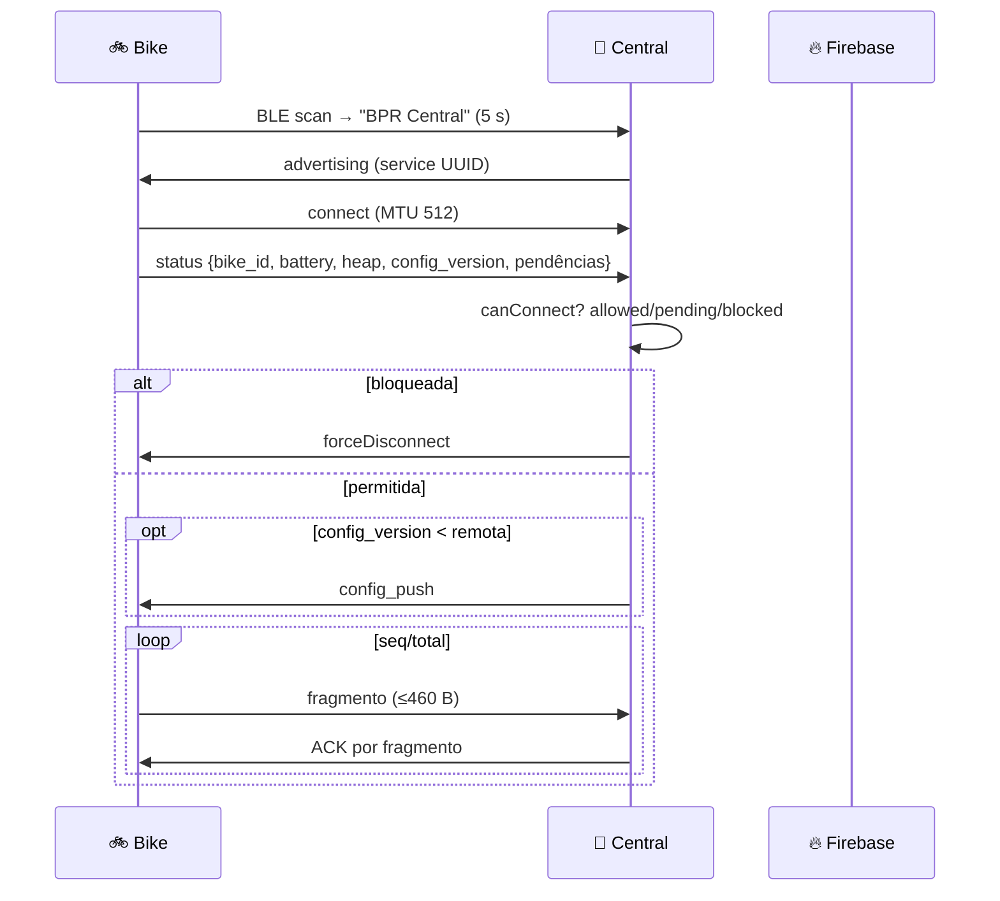
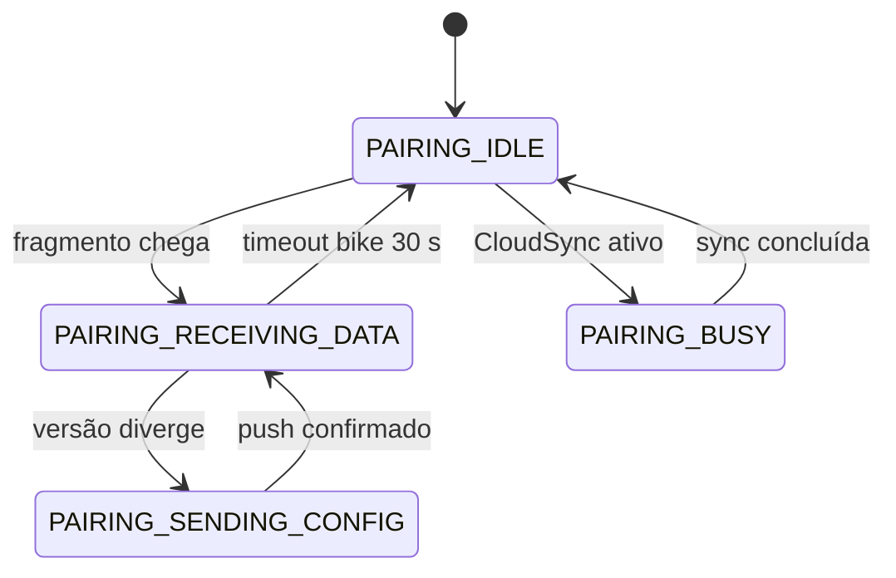

# Protocolo BLE Bike ↔ Central

Documento canônico do protocolo. Histórico em `BIKE_CENTRAL_PROTOCOL.md` e
`INTERACAO_BIKE_CENTRAL.md` (cenários ilustrativos, não norma). O comportamento vigente
vem de `firmware/common/bpr_protocol.h`, `firmware/bici/include/at_base.h`,
`firmware/central/include/ble_server.h` e `firmware/central/src/bike_pairing.cpp`.

## 1. Identidade e descoberta



- Nome anunciado da central: `BPR Central` (`CENTRAL_BLE_NAME`, `AP_SSID` idem`).
- ID da bike: `bpr-XXXXXX` (10 caracteres, `generateBikeId()` = eFuse MAC).
  A central valida formato e compara contra o registro Firebase.

## 2. UUIDs e limites

| Constante | Valor | Papel |
|---|---|---|
| `BLE_SERVICE_UUID` | `12345678-1234-1234-1234-123456789abc` | Serviço principal |
| `BLE_CHAR_DATA_UUID` | `87654321-4321-4321-4321-cba987654321` | Bike→Central (status, fragmentos) |
| `BLE_CHAR_CONFIG_UUID` | `11111111-2222-3333-4444-555555555555` | Push config (notificações) |

### Limites de transporte

| Parâmetro | Valor | Origem |
|---|---|---|
| MTU negociado | 512 (`NimBLEDevice::setMTU(512)`) | bike `main.cpp`, central `bpr_protocol.h` |
| Payload máxima do fragmento | 460 B | `MAX_BLE_FRAGMENT_BYTES` (MTU − overhead) |
| Fragmentos por mensagem | 1 chunk = subconjunto de redes que cabe no orçamento | `FragmentChunk {scan_idx, net_start, net_count}` |
| Arena JSON do fragmento | 1280 B | `FRAGMENT_JSON_ARENA` (não confundir com payload) |
| ACK por fragmento | timeout 5 s, máx 3 retries | `FRAGMENT_ACK_TIMEOUT_MS`, `MAX_FRAGMENT_RETRIES` |
| Timeout de conexão | 10 s | `BLE_CONNECTION_TIMEOUT` / `connection_timeout_ms` |
| Janela da visita | 300 s | `AT_BASE_MAX_DURATION_MS` |
| Pedido de config | timeout 10 s, 3 retries | `CONFIG_REQUEST_TIMEOUT_MS` |
| Fila de notificações da bike | 516 B máx/notificação | `NOTIF_MAX_LEN` |

> ⚠️ **Divergência documentada:** `firmware/common/README.md` e READMEs antigos
> mostram Data `12345678-...-abd` / Config `...-abe`. O código atual (bike
> `include/constants.h` + `common/bpr_protocol.h`) usa `8765...` / `1111...`.
> **Reflashe bike e central juntos**; se os UUIDs divergirem, a descoberta falha
> silenciosamente.

## 3. Mensagens JSON

### 3.1 `status` (heartbeat — bike → central, a cada conexão e a cada 5 s em `AT_BASE`)

```json
{
  "bike_id": "bpr-000123",
  "type": "status",
  "battery_percent": 85,
  "battery_voltage": 3.82,
  "heap": 45000,
  "last_update": 1733400000,
  "config_version": 2,
  "uptime_sec": 3600,
  "pending_data": { "sessions_count": 1, "total_bytes": 1200, "buffer_usage_percent": 12 }
}
```

> `type` esperado no lado da central é `"status"` para heartbeat
> (`MSG_TYPE_STATUS`). O protocolo histórico também chama isso de `heartbeat`;
> ambos os nomes aparecem no código — `bike_pairing.cpp` aceita `type=="status"`.

### 3.2 Fragmento — `wifi_data` (bike → central)

```json
{
  "bike_id": "bpr-000123",
  "type": "wifi_data",
  "session_id": 45000,
  "session_salt": 2,
  "seq": 0,
  "total": 3,
  "is_final": false,
  "boot_id": 7,
  "session_start_millis": 45000,
  "scan_count": 12,
  "scans": [
    { "idx": 3, "ts": 47000, "net_offset": 0, "nets": [["NET_5G", "AA:BB:CC:11:22:33", -70, 6]] }
  ],
  "battery": []
}
```

- Fragmentos **intermediários** transportam `scans[]` (pode ser um chunk de um scan denso);
  o fragmento **final** (`is_final: true`, `seq == total-1`) transporta `battery[]`,
  `resumed` (sessão retomada entre boots) e o resumo da sessão.
- `idx` identifica o scan de origem na sessão (N04/N05): chunks de um mesmo
  scan carregam o mesmo `idx` e o consumidor os reúne em uma observação.
- **Capacidade (N06):** o pior caso legítimo da bike (50 scans × 20 redes com
  SSID de 32 aspas → escape JSON) gera **501 fragmentos**; a central acomoda
  **512 fragmentos por bike** (`MAX_SESSION_FRAGMENTS`) e 800 itens totais —
  `total > 512` é violação de contrato e a sessão não completa.
- A central persiste `BufferItemBin {bikeId, timestamp, size, crc32, session_id, salt, seq, uploaded, confirmed, data[512]}`.
- O ACK de cada fragmento indica recebida; **a bike só apaga o buffer** após
  `upload_confirmed` (resp. da central) + limpeza local (`bufferManager.clear()`).

### 3.3 `config_request` / `config_push` / `config_received`

```json
{ "type": "config_request", "bike_id": "bpr-000123", "timestamp": 45000 }
{ "type": "config_push", "bike_id": "bpr-000123", "version": 3, "config": { "...": "..." } }
{ "type": "config_received", "bike_id": "bpr-000123", "status": "ok", "timestamp": 45000 }
```

- Pedido é feito por `AtBaseState::requestConfig()` com retry (X08);
  o ACK `config_received` marca `configReceived`.
- **Push automático:** se o heartbeat da bike carrega `config_version` inferior à
  remota, a central envia `config_push` via Notificação (fila `BPRBLEServer::pushConfigToBike`,
  `processPushQueue()` no contexto do loop — não na task NimBLE). A bike aplica
  atomicamente (`ConfigManager::processUpdate`); campo inválido rejeita tudo.
- `central` também responde `busy {retry_after_sec}` quando está em `CLOUD_SYNC`;
  a bike espera `busyUntilMs` real (R13) antes de tentar de novo.

### 3.4 `upload_confirmed` (central → bike)

```json
{ "type": "upload_confirmed", "bike_id": "bpr-000123", "can_clear_buffer": true, "next_checkin_sec": 300 }
```

## 4. Garantias de entrega

| Propriedade | Mecanismo |
|---|---|
| Sem duplicatas de sessão no Firebase | `session_id+salt` estáveis; lote imutável; projeção `sessions_v2` só quando completo |
| Retomada pós-desconexão | Bike lembra `lastSessionId/Salt + fragIndex` (X02); central não perde `seq` já confirmados |
| Buffer na bike | LittleFS atômico (tmp+rename), header `magic=BPRS + version=3 + payload_crc` (F08/R22); quarentena de arquivo suspeito |
| Buffer na central | LittleFS 800 × (512+24) B; lotes imutáveis com `batchKey` estável |
| Segurança | `canConnect` bloqueia `blocked`; `pending` grava só visita/heartbeat; `isAllowed` para dados; fila sequencial `PairingStatus` (idle/receiving/sending/busy) |

## 5. Diagramas

### 5.1 Fragmentação ponta a ponta

```mermaid
flowchart LR
    subgraph Bike["Bike (SessionData)"]
        S1["scan denso (20 redes)"]
        S2["72 kB acumulados"]
    end
    Bike -->|"buildChunks()"| F1["frag 0: 7 redes (≤460 B)"]
    Bike --> F2["frag 1...N-1: chunks"]
    Bike --> FN["frag final: battery[]"]
    F1 -->|BLE| C["Central"]
    F2 -->|BLE| C
    FN -->|BLE| C
    C -->|BufferItemBin| L[(LittleFS)]
    L -->|uploadBufferData| FB[(RTDB /data/{batchKey})]
```

### 5.2 Estados de pareamento na central



### 5.3 Falhas encontradas no campo (mapeamento)

| Falha | Efeito observável | Recuperação |
|---|---|---|
| UUIDs divergentes | Bike nunca encontra a central | Reflashe bike+central juntos |
| Buffer bike cheio | Scans param; permanece em SCANNING | Buscar base (agenda 30 s); ao conectar, transfere e limpa |
| Central `busy` | `busy` + `retry_after_sec` | Bike aguarda `busyUntilMs` e retenta |
| Fragmento perdido | Sem `is_final` no Firebase | Functions aguarda completar; bike retenta seq |
| `blocked` | Desconexão forçada | Admin libera em `/bases/{id}/bikes/{bikeId}/status` |
