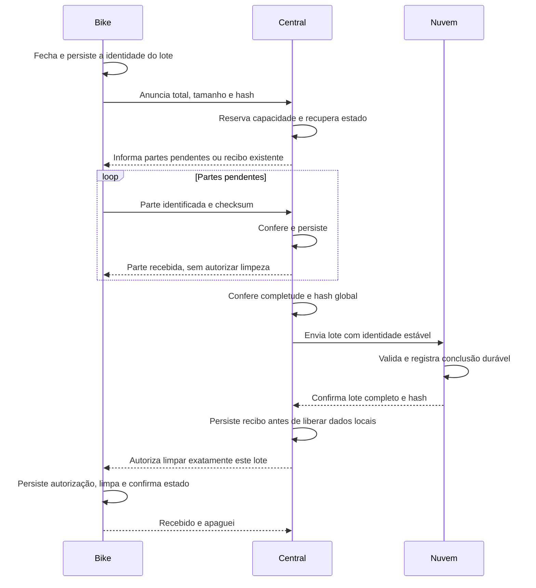

# BPR — PRD de transferência de lotes, integridade e recibos

**Versão:** 1.0 — 7 de novembro de 2026, America/Recife.  
**Status:** desenho funcional aprovado pelo usuário para documentação. Implementação, migração e validação ainda não executadas.  
**Escopo:** segunda parte da discussão: entrega bike → central → nuvem, retomada e limpeza dos buffers.  
**Base técnica da análise anterior:** Ameciclo/bpr-sistema, fixes/november, commit `7a3533b443d43bc39d9519afbb4d3945aa4d1a7b`. Conferir alterações posteriores antes de implementar.

## 1. Problema e resultado esperado

A bike pode repetir uma entrega porque caiu a conexão, houve reboot ou a confirmação final se perdeu. A central pode já ter enviado dados à nuvem e removido sua cópia. Se a conclusão depender apenas das partes ainda presentes no buffer local, a retomada pode ficar esperando dados que já foram entregues.

O sistema deve reconhecer a entrega pelo mesmo identificador, conferir seu conteúdo e responder novamente pelo estado persistido. A bike só pode apagar o conjunto depois de receber autorização ligada à confirmação durável do lote completo na nuvem.

Esta entrega não depende de reconstruir horários, calcular localização ou terminar os agregados públicos. Esses serviços podem trabalhar depois que os dados originais estiverem guardados. A bike não acessa a internet: comunica-se com a central, que envia os dados à nuvem.

## 2. Decisões consolidadas

| Tema | Decisão deste PRD |
|---|---|
| Unidade da entrega | Lote fechado: conjunto imutável de observações selecionadas para uma transferência. |
| Partes esperadas | Total anunciado antes da recepção; cada parte tem índice e pertence a uma única identidade de lote. |
| Identidade | bike_id + lote_id + versão do formato. Repetir a entrega conserva a identidade e o conteúdo. |
| Conferência por parte | Tamanho e CRC32 de variante explicitamente definida no contrato do protocolo. |
| Conferência do conjunto | SHA-256 do lote, com representação de bytes definida e verificável entre os participantes. |
| Lista de IDs | Derivada do lote e do intervalo de índices. Não enviar, por padrão, uma longa lista de hashes individuais. |
| Partes repetidas | Mesmos ID/conteúdo contam uma vez; conteúdo diferente com o mesmo ID é conflito. |
| Liberação da bike | Somente depois da confirmação de armazenamento completo e validado na nuvem. |
| Recibo | Persistente; continua disponível depois de remover os dados que comprova. |
| Coleta durante envio | Novas observações ficam fora do lote já fechado e são preservadas. |
| Processamento de rota | Posterior e independente da autorização de limpeza. |

O contrato deverá fixar uma única convenção de índices. Nos exemplos humanos usamos partes 1 a 56; uma implementação que mantenha índices de 0 a 55 deve declarar isso na versão do protocolo e validar os limites sem ambiguidades.

Viagem/ciclo de coleta, lote de entrega e parte são entidades diferentes. Uma viagem pode precisar de mais de um lote. Uma observação densa pode ocupar várias partes. Este PRD não decide quando uma pedalada física começa ou termina.

## 3. Fluxo principal

As mensagens do diagrama são operações lógicas. O envio à nuvem pode envolver vários pedidos físicos. Um pedido isolado bem-sucedido não representa a entrega completa se ainda faltam dados do lote.

## 4. Contratos de dados e integridade

### 4.1 Anúncio e identidade

O anúncio deve declarar a bike, o lote, a versão do formato, o total de partes, o total de bytes e o hash global. Sua identidade e os dados necessários para reconstruir as mesmas partes devem sobreviver a reboot da bike. Um retry não cria outro lote.

A estação é proveniência da entrega. A mesma origem reapresentada em outra estação deve poder ser reconciliada pela identidade do lote, sem criar outro registro lógico. O serviço remoto conserva uma confirmação canônica independente da estação que fez o upload.

Congelar o conjunto, sua ordenação e a representação dos dados antes de transmitir. Novas observações não alteram o total ou os cabeçalhos de partes já confirmadas. Uma correção legítima do conteúdo precisa de revisão/identidade explícita e não pode reutilizar autorização de limpeza do conteúdo anterior.

### 4.2 Partes e pendências

Cada parte deve levar identidade do lote, índice, comprimento e checksum do conteúdo definido pelo protocolo. A central valida a parte, verifica sua persistência e só então confirma sua recepção. O conjunto de índices válidos persiste independentemente de um contador de mensagens recebidas.

Solicitar novamente partes faltantes ou inválidas. Receber partes fora de ordem não autoriza descartar as que já foram validadas. A consulta de pendências também deve caber no transporte, usando representação compacta ou paginação quando necessário.

Não confirmar apenas porque a parte entrou numa fila ou existe em RAM. A leitura após persistência e a recuperação do armazenamento devem permitir detectar gravação incompleta/corrompida. Se a confirmação local se perde, o reenvio da mesma parte deve reconhecer a duplicata válida.

### 4.3 Hash do lote

O hash deve cobrir uma representação inequívoca dos metadados imutáveis e das partes ordenadas: versão, identidade da bike/lote, total e sequência de índices, comprimentos e conteúdos. O contrato de bytes precisa ser definido antes da implementação e possuir vetores de exemplo compartilhados entre firmware e backend.

Não calcular em cada lado a partir de uma serialização JSON incidentalmente diferente. Ordem de chaves, números, codificação e fronteiras entre partes devem ter uma regra única. Horários de contato ou outros metadados adicionados posteriormente ficam separados do conteúdo congelado.

Concluir somente quando o conjunto de índices for exatamente o esperado, os tamanhos forem consistentes e o hash global corresponder ao anunciado. Se todas as partes passarem no checksum mas o hash global divergir, manter o lote pendente para diagnóstico/reconciliação.

Um SHA-256 ocupa 32 bytes. A alternativa de anunciar 56 hashes SHA-256 individuais ocuparia 1.792 bytes binários antes dos IDs/cabeçalhos. Por isso, este PRD adota o anúncio compacto com hash global e conferência por parte. Um manifesto explícito maior exigiria seu próprio transporte fragmentado e não faz parte do caminho inicial.

## 5. Confirmação remota e limpeza

### 5.1 Significado dos estados

| Estado | O que já está comprovado | Pode limpar na bike? |
|---|---|---|
| Recebendo | Apenas algumas partes foram persistidas. | Não. |
| Completo localmente | Partes e hash global conferem na central. | Não. |
| Aguardando nuvem | Ainda não há confirmação remota do conjunto completo. | Não. |
| Confirmado na nuvem | Conteúdo completo armazenado e validado; registro remoto de conclusão. | Após a bike receber e persistir a autorização correspondente. |
| Autorização persistida na bike | A bike reconhece qual conteúdo pode liberar. | Pode executar/concluir a limpeza desse lote. |
| Limpeza concluída | Estado resultante persistido na bike. | Pode responder novamente “apaguei”. |

O registro remoto de conclusão deve ser instalado somente depois de validar o lote completo e referenciar os dados imutáveis correspondentes. O consumidor normaliza/processa o lote confirmado, preservando a identidade de origem. Repetições do upload e eventos do backend precisam convergir para o mesmo registro, sem publicar cópias do lote como novas viagens.

### 5.2 Ordem das gravações

Na central: receber confirmação remota → persistir recibo → remover payload local quando conveniente → enviar/repetir autorização de limpeza.

Na bike: receber autorização → persistir autorização e cobertura → remover apenas os registros cobertos → persistir o estado final → responder “recebido e apaguei”. A implementação deve usar operações recuperáveis para que qualquer reboot entre essas etapas consiga terminar a limpeza ou reconhecer que ela já terminou.

O recibo deve identificar, no mínimo, bike/lote, versão, total/tamanho, hash e estado confirmado. A resposta não pode autorizar limpar todo o buffer atual por conveniência: observações novas e outros lotes permanecem.

### 5.3 Confirmações perdidas

Se “pode apagar” se perder, a central responde novamente pelo recibo, mesmo sem payload local. Se “apaguei” se perder, a bike responde novamente pelo seu estado persistido. Não criar uma cadeia infinita de confirmações para confirmar confirmações.

A ausência de payload não comprova entrega. A presença de um recibo validado ou a recuperação da confirmação remota é que permite autorizar a limpeza.

O cache local de recibos pode ter uma política limitada, desde que não remova a última evidência necessária à retomada. Conservar confirmação remota canônica e recuperável. Sem recibo local e sem conseguir consultar a nuvem, informar pendência; não inferir sucesso. A política de retenção e recuperação deve ser descrita no contrato e testada, inclusive em outra estação.

## 6. Capacidade, conexão e compatibilidade

A estratégia inicial é manter as partes locais até validar o lote e confirmar a nuvem. Se houver necessidade de drenar partes antes, isso só atende a este PRD com comprovantes duráveis independentes do payload, mantendo a mesma garantia de completude. A drenagem não pode apagar o conhecimento de que determinada parte já foi entregue.

Reservar capacidade para terminar as entregas admitidas. A central pode serializar a admissão de lotes no MVP e responder “ocupada/sem espaço” antes de aceitar outro. Dimensionar espaço para dados, recibos, cabeçalhos, temporários, configuração e recuperação. Não aceitar vários lotes parciais que só possam liberar espaço após ficarem completos, sem espaço para completar qualquer um.

Na base revisada, os limites eram 512 fragmentos por bike e 800 itens globais, com um cenário denso de 501 partes. Dois cenários assim excedem o teto global. Esses valores são evidência do commit analisado, não capacidade garantida do novo formato. Recalcular o número de partes com os campos deste protocolo.

Todas as mensagens devem respeitar o limite de aplicação vigente, de 460 B no código analisado, contando identidade, checksums e demais cabeçalhos. Validar também o MTU efetivamente negociado. Anúncios, recibos e respostas de pendências entram no mesmo orçamento. Não aumentar os limites sem novo dimensionamento.

Se a central estiver sem internet, pode receber apenas dentro da capacidade admitida e deve informar “aguardando nuvem”. A bike mantém sua cópia até um contato permitir obter a autorização. Não exige internet na bike nem espera BLE indefinida para resolver uma indisponibilidade remota.

Versionar e negociar a capacidade deste protocolo antes de usar seus estados. Planejar atualização de backend/central antes das bikes que dependam dos novos recibos. Equipamento incompatível deve preservar os dados e fornecer diagnóstico; não interpretar uma confirmação antiga de parte como a nova autorização de limpeza do lote inteiro. Dados legados precisam de tratamento explícito, sem confirmar retroativamente uma entrega que não foi verificada.

## 7. Matriz de aceite

Os cenários abaixo são requisitos para a implementação futura. Não foram executados por este documento.

| ID | Cenário | Resultado exigido |
|---|---|---|
| T01 | 56 partes, fora de ordem, com duplicatas idênticas. | Concluir uma entrega apenas quando todas as sequências válidas estiverem presentes. |
| T02 | Parte ausente, truncada ou checksum inválido. | Parte pendente; nenhum recibo final; reenvio seletivo. |
| T03 | Mesmo ID de parte com conteúdo diferente. | Conflito explícito; não sobrescrever nem contar como duplicata válida. |
| T04 | Índice negativo/fora do intervalo ou total/tamanho inconsistente. | Rejeitar mensagem/conjunto sem avançar a completude. |
| T05 | Todos os checksums locais passam, mas o hash global diverge. | Não confirmar o lote nem autorizar limpeza. |
| T06 | Gravação local falha depois que a parte entrou na fila. | Não confirmar persistência; a bike conserva a cópia. |
| T07 | Conexão cai e bike/central reiniciam no meio do lote. | Recuperar identidade, progresso e partes necessárias, sem mudar o conteúdo. |
| T08 | Prefixo já foi confirmado remotamente e removido localmente. | Retomada conhece a custódia; não espera payload já entregue para provar completude. |
| T09 | Internet indisponível ou apenas alguns uploads terminaram. | Estado pendente; dados preservados na bike; nenhum recibo remoto de conjunto completo. |
| T10 | Duas instâncias enviam o mesmo lote à nuvem. | Uma conclusão canônica; mesmos ID/hash reutilizam o resultado. |
| T11 | Autorização final se perde depois da remoção do payload na central. | Central repete a autorização pelo recibo. |
| T12 | Resposta “apaguei” se perde. | Bike reconhece estado concluído e responde novamente sem recriar entrega. |
| T13 | Corte de energia antes/depois de cada gravação de recibo e de limpeza. | Retomada recuperável; nenhum dado não confirmado apagado. |
| T14 | Novos pontos entram durante a transferência. | Ficam fora da cobertura do recibo e continuam armazenados. |
| T15 | Dois lotes densos disputam a capacidade da central. | Admissão/reserva evita saturação sem progresso e fornece diagnóstico. |
| T16 | MTU menor ou mensagem com novos campos excede o tamanho permitido. | Recusa/negociação compatível antes de comprometer a entrega; dados preservados. |
| T17 | Outro serializador verifica os mesmos dados. | Vetores de bytes/hash concordam segundo o contrato, independentemente da ordem incidental de objetos. |
| T18 | Mesmo lote retorna por outra estação ou após expirar cache local. | Recupera confirmação remota pelo ID/hash; sem confirmação acessível, mantém pendência. |
| T19 | Geolocalização demora ou falha depois do armazenamento completo. | Transferência permanece concluída; processamento posterior é recuperável e separado. |
| T20 | Bike/central antigos entram no fluxo novo. | Versão/capacidade reconhecida; nenhuma limpeza fundada num ACK de significado diferente. |

Usar SDK/emulador real para comportamento de gravação, concorrência e conclusão remota, além de testes locais do protocolo. Em placa, validar quedas de alimentação, BLE interrompido, recuperação do sistema de arquivos, espaço baixo e indisponibilidade de internet. Builds aprovados sozinhos não demonstram essas propriedades.

## 8. Plano de implementação e definição de pronto

1. Registrar o contrato de bytes, índices, CRC32, hash e versões, com vetores compartilhados.
2. Implementar identidade e snapshot recuperáveis na bike; estados e reserva na central.
3. Implementar armazenamento remoto imutável por origem e conclusão verificável.
4. Implementar recibos persistentes e retomada em todos os pontos de falha.
5. Ajustar os consumidores para processar conjuntos confirmados e preservar a identidade existente.
6. Validar capacidade e tamanho real das mensagens; executar a matriz de aceite.
7. Planejar compatibilidade/migração e atualização gradual em bancada antes da operação.

Diagnóstico mínimo: partes válidas/esperadas, bytes persistidos, estado da confirmação remota, idade da pendência, conflitos/hash divergente, reenvios, espaço/reservas e último recibo. Não é necessário colocar esses detalhes na interface pública.

Pronto significa matriz de falha e recuperação atendida, contratos compatíveis, ausência de limpeza prematura, uma entrega lógica por identidade e evidência de validação real. Este PRD está pronto como especificação; não declara a correção implementada ou implantada.

## 9. Documentos relacionados

- [Discussão original, revisão 0.2](https://chatgpt.com/library?file_id=libfile_ffe082edd17c8191bfcf151fe74f9e4f&account_id=personal): origem das decisões e alternativas consideradas.
- [Revalidação do 7a3533b](https://chatgpt.com/library?file_id=libfile_9ac148d13478819196b426b593823462&account_id=personal): evidência da análise de código que motivou este fluxo.
- [Correções dos itens 2, 4 e 5](https://chatgpt.com/library?file_id=libfile_7766cb4a3220819196ca054fccb8e430&account_id=personal): identidade dos agregados, período do replay e preservação concorrente das coordenadas.
- [NIST — FIPS 180-4](https://csrc.nist.gov/pubs/fips/180-4/upd1/final): definição do SHA-256. A escolha de usá-lo neste lote é decisão de projeto documentada aqui.

O patch de horários continua em modelagem separada. Nenhum código foi gerado ou alterado nesta entrega.
